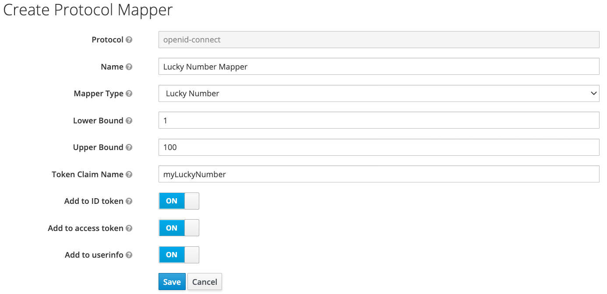

# Keycloak OIDC protocol token mapper

This is an example token mapper for Keycloak using the OIDC protocol.

You can configure the mapper with an upper and a lower bound and it will generate a random lucky number (integer) and maps it into the specified token(s) (and userinfo endpoint) to the specified claim.

## YouTube Video

## Lookup User Roles mapper

`LookupUserRolesMapper` (`oidc-lookup-user-roles-mapper`) writes the realm and client roles of **another user**, found by
username, into the **access token** and the **token introspection response** (not ID token, not userinfo).

| Config | Meaning |
|--------|---------|
| Lookup Username | user whose roles are used |
| Merge | on: add to the current user's roles; off: replace them (`realm_access`, `resource_access` and the claims below are cleared first) |
| Realm roles claim name / prefix | default `realm_access.roles` |
| Client roles claim name / prefix | default `resource_access.${client_id}.roles`; roles of all (enabled) clients |

Roles are resolved like the built-in role mappers do: composites expanded, restricted by the requesting client's scope
(full scope allowed / role scope mappings). If the user is not found, the token stays unchanged and a warning is logged.

Things to be aware of:

- The mapper has priority 41 (role mappers: 40, script mapper: 50) so it runs after the built-in role mappers.
- The `aud` claim is resolved by the audience resolve mapper (priority 30) **from the current user's roles**, before this mapper
  runs. It is not adjusted to the looked-up user's roles.
- In replace mode, roles written by other mappers to claim paths *other* than `realm_access`, `resource_access` and the two
  configured paths are not removed.
- Only realm admins can configure mappers, but this effectively lets a client's tokens carry another user's roles. Use a
  dedicated, minimally privileged user.
